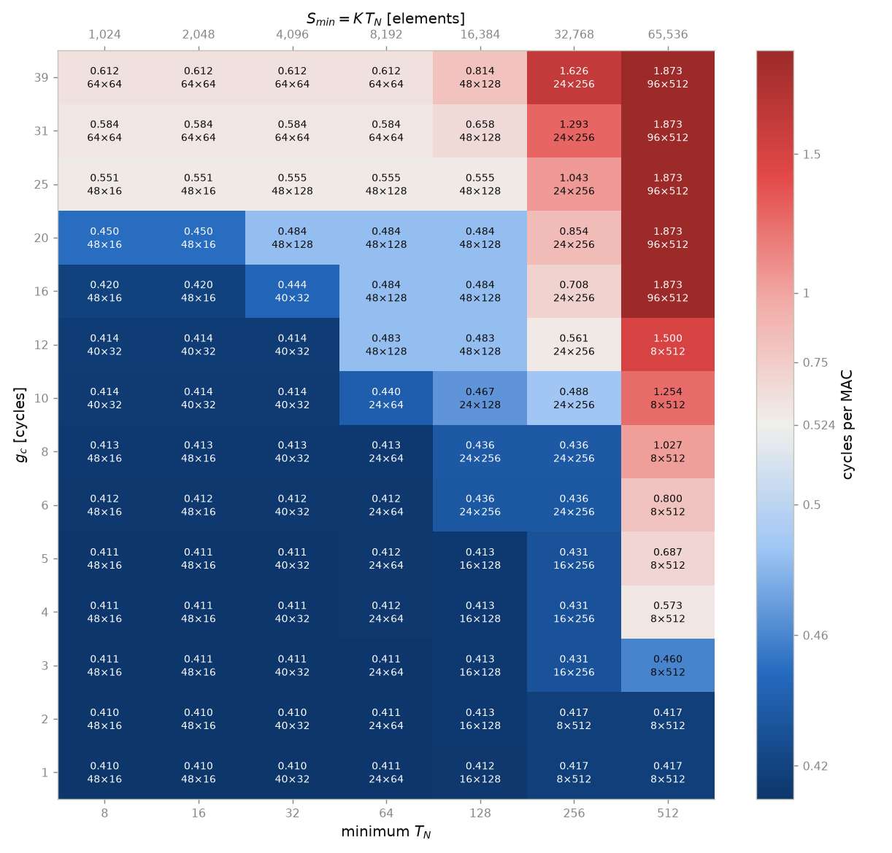
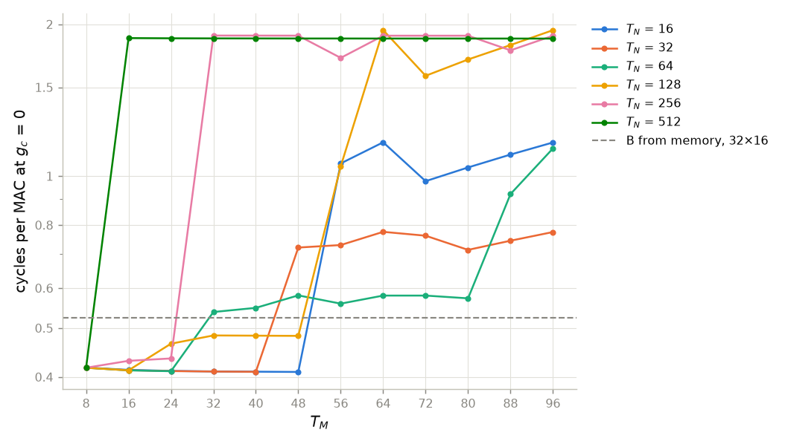
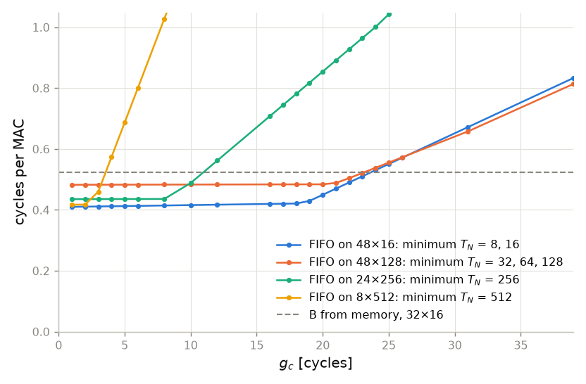
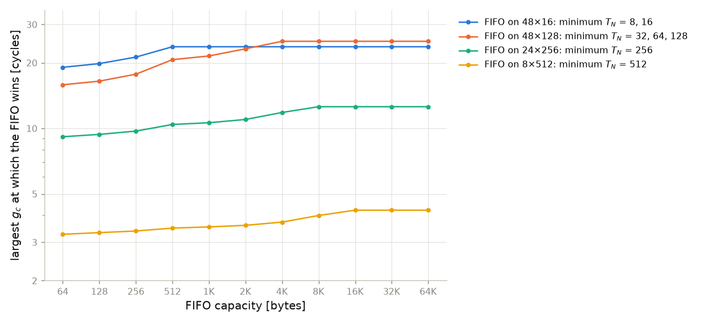

# constraint_tile-v2: the FIFO when the generator needs large B tiles

Some generators need to make at least S_min elements from each seed, for the
quality of their numbers or to pay back their start-up. The FIFO takes one
seed per tile, and with T_K = K a tile's B block is K × T_N elements, so such
a generator needs tiles at least S_min / K wide. This experiment asks what
that minimum width costs, and when it makes loading B from memory the faster
choice. Memory-B reads B and has no minimum.

The machine is the one of [fifo_feasibility-v2](../fifo_feasibility-v2/README.md):
its working point, its 84 tiles (T_M from 8 to 96 in steps of 8, T_N from
8 to 512) and its 2 KB FIFO. With K = 128, the minimum widths 16 to 512
are B tiles of 2,048 to 65,536 elements. g_c is the generator's cycles per
element of B. The runs come from fifo_feasibility-v2's cache, except the
979 runs of the FIFO-size graph, which are cached in
`out/constraint_tile-v2/results.json`.

run: `.venv/bin/python experiments/rewrite/constraint_tile-v2.py`

## Which tile to run, and when to load B instead



The map has a column for each minimum width, from T_N ≥ 8, which allows
every tile, to T_N ≥ 512, and a row for each generator cost up to
g_c = 39. The top axis gives the same minimum as S_min = K·T_N
elements. Each cell names the fastest tile at least that wide and its cycles
per MAC with the 2 KB FIFO. Tiles within 0.5% of each other count as tied, and
the cell names the one with the fewest tile rows. Memory-B's fastest tiles,
32×8, 32×16 and 32×32, take 0.524 cycles per MAC, the gray middle of the colour
scale: blue cells beat memory-B, red cells lose to it.

- With a fast generator the minimum hardly matters. At g_c = 1 the fastest
  tile under every minimum takes 0.410 to 0.417 cycles per MAC, because
  every width has a tile short enough to keep in L1 what its tile row reuses.
- For minimums up to T_N ≥ 128, B tiles of 16,384 elements, the
  FIFO still beats memory-B while g_c < 23.2, against
  23.7 with no minimum. A wide minimum allows only short tiles
  that keep A in L1, and a short tile can't hide as slow a generator, so the
  FIFO moves to 48×128 at 0.482 cycles per MAC. While the FIFO
  still wins, that costs up to 17%: at g_c = 12, T_N ≥ 64 runs
  48×128 at 0.483 cycles per MAC, against 0.414 on 40×32 with
  no minimum.
- Wider minimums cut the slowest generator that still wins: T_N ≥ 256 to g_c = 11.0 and T_N ≥ 512 to g_c = 3.6.
- A generator slower than 23.7 cycles per element loses to memory-B under
  every minimum and with none, so there the minimum doesn't change the
  decision.

## Why, and how to find the tile for your own minimum



Cycles per MAC with a generator that costs nothing, against the tile's
height, one line per width, and memory-B's 0.524 dashed. While the A band
and two C tiles fit in L1 (f ≤ 1), a tile takes 0.409 to 0.418 cycles per MAC.
A wider tile has a wider C tile, so fewer rows fit: the tallest tile with
f ≤ 1 is 48 rows at T_N = 16, 40 rows at T_N = 32, 24 rows at T_N = 64, 16 rows at T_N = 128 and 8 rows at T_N = 256. At T_N = 512
there is one tile column, so only the tile limit applies, and it allows
8 rows. Past f = 1, A is read again for every tile column, which costs
little when there are few: 48×128 takes 0.482 cycles per MAC with 4 tile columns and 24×256 takes 0.435 cycles per MAC with 2 tile columns.
Past the tile limit, T_M·(max(T_N·A_P, line) + 2·line) > L1, the C tile no
longer stays in L1 from one k step to the next, and the cost jumps to
0.9 to 1.9 cycles per MAC.

The generator sets the other half. B is generated once per tile row, so each
element serves T_M MACs. Section 1 of fifo_feasibility-v2 found that a tile
then takes about

```
FIFO cycles per MAC ≈ max(cycles per MAC at g_c = 0, g_c · ⌈M/T_M⌉ / M)
```

A tile therefore beats memory-B while its point in the graph is below the
dashed line and g_c < T_M × 0.524, with M/⌈M/T_M⌉ in place of T_M when T_M
doesn't divide M. The slower the generator, the taller the tile it needs.
Under a minimum, the tile for the slowest generator is the tallest one at
least that wide whose point is below the dashed line:

| minimum T_N | S_min, elements | tallest tile below memory-B | its cycles per MAC at g_c = 0 | slowest g_c by the rule | measured, 2 KB FIFO |
|---|---|---|---|---|---|
| 8 to 16 | 1,024 to 2,048 | 48×16 | 0.409 | 25.2 | 23.7 |
| 32 to 128 | 4,096 to 16,384 | 48×128 | 0.482 | 25.2 | 23.2 |
| 256 | 32,768 | 24×256 | 0.435 | 12.6 | 11.0 |
| 512 | 65,536 | 8×512 | 0.417 | 4.2 | 3.6 |

The rule is 6 to 14% optimistic. The FIFO-size section shows where
the gap comes from.

## The four tiles against g_c



Cycles per MAC against g_c on the tiles of the table, with the 2 KB FIFO, and
memory-B dashed. Each line stays at its cost with a free generator until
g_c · ⌈M/T_M⌉ / M overtakes it, and climbs from there. 48×128 starts
0.073 cycles per MAC above 48×16, but both are 48 rows tall, so
from g_c ≈ 23 they climb together and cross memory-B at nearly the same
g_c. The shorter tiles climb faster, because B is generated once per tile
row: 8 times on 24×256 and 24 times on 8×512, against
4 times on the 48-row tiles.

## How big a FIFO



The slowest generator at which each tile of the table still beats memory-B
on 32×16, against FIFO capacity. The wider the tile, the larger the FIFO it
needs to get to the rule's limit.

| tile | minimum T_N | slowest g_c by the rule | 2 KB FIFO | 64 KB FIFO | elements made during the C tile's misses, at the rule's g_c | smallest FIFO within 1% of 64 KB |
|---|---|---|---|---|---|---|
| 48×16 | 8, 16 | 25.2 | 23.7 | 23.7 | 391 | 512 B |
| 48×128 | 32, 64, 128 | 25.2 | 23.2 | 25.1 | 3,127 | 4 KB |
| 24×256 | 256 | 12.6 | 11.0 | 12.6 | 6,255 | 8 KB |
| 8×512 | 512 | 4.2 | 3.6 | 4.2 | 12,509 | 16 KB |

At the start of every tile the FIFO is empty, and the core reads every line
of the C tile from DRAM, one miss after another (fifo_feasibility-v2,
simulator issues). The generator works ahead during those misses. A FIFO
that holds what it makes there, T_M·⌈T_N·A_P/line⌉·(t_mem + t_1) / g_c
elements, keeps that lead for the rest of the tile. A wider tile has a wider
C tile and a longer stretch of misses. With that much FIFO,
48×128, 24×256 and 8×512 reach the rule's limit.

48×16 stays 6% below the rule at any capacity. The
first tile of each of its tile rows reads the A band from DRAM, and the
31 later tiles don't, so the generator has time to spare in the first
tile and too little in the others. The FIFO restarts empty at every tile and
can't carry the spare time over; the worked example in fifo_feasibility-v2's
composite section takes 48×16 apart tile by tile. On
48×128 every tile reads A again, so all its tiles are alike.

## Composite graphs

`composites/` holds what each minimum costs against γ₀, with the fastest tile
written in every point. [composites/README.md](composites/README.md) explains
the graphs.

## Simulator issues these runs expose

- The FIFO starts empty at every tile, so the time a generator gains while
  the core is slow in one tile can't carry into the next. That keeps the
  FIFO on 48×16 below the rule at any FIFO size.
- At the start of every tile the core reads its whole C tile from DRAM, one
  miss after another, before it computes. That stretch sets the FIFO size
  the wide tiles need.
- T_K is always K, so a minimum B tile can only be met by widening T_N. With a
  tile-level T_K, a B tile of T_K × T_N could also grow along K; this
  simulator can't test that.

## Changes from the first version

The first version is `constraint_tile.py`, with its outputs in
`out/constraint_tile/`; both are unchanged. It gave each minimum's cost as
the fastest allowed tile over the fastest tile of any width, against γ₀. This
version compares the FIFO under each minimum with memory-B's fastest tile, in
cycles per MAC and g_c, and moves the cost against γ₀ to `composites/`, with
the fastest tile written in every point. It also finds the tile a minimum
runs near its limit from the cycles per MAC at g_c = 0, measures how the FIFO
size moves that limit, and runs N = 512 with minimums up to T_N ≥ 512, where
the first version ran N = 256.
