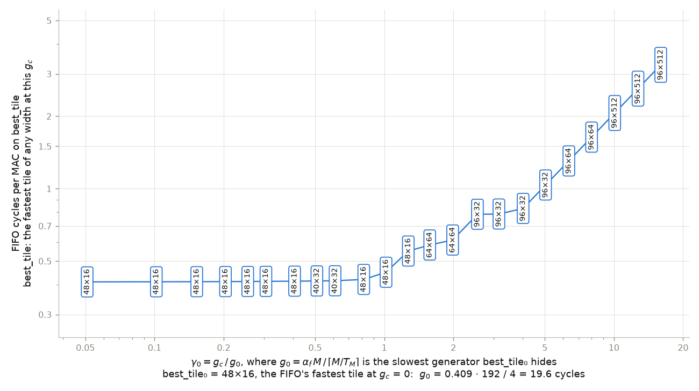
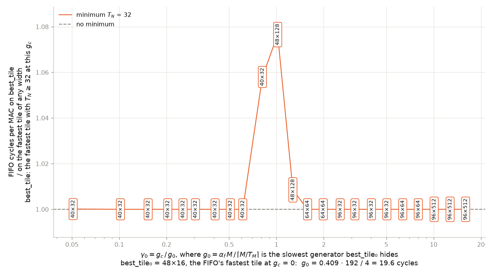
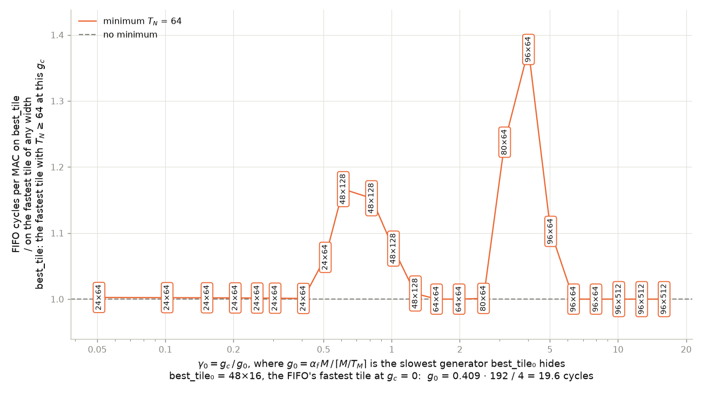
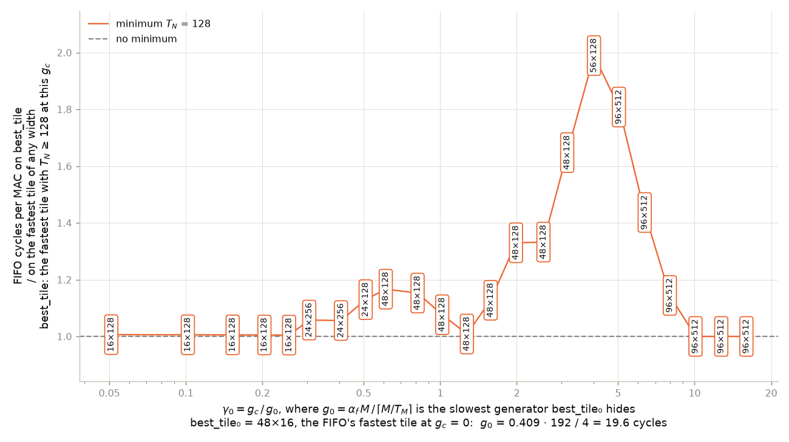
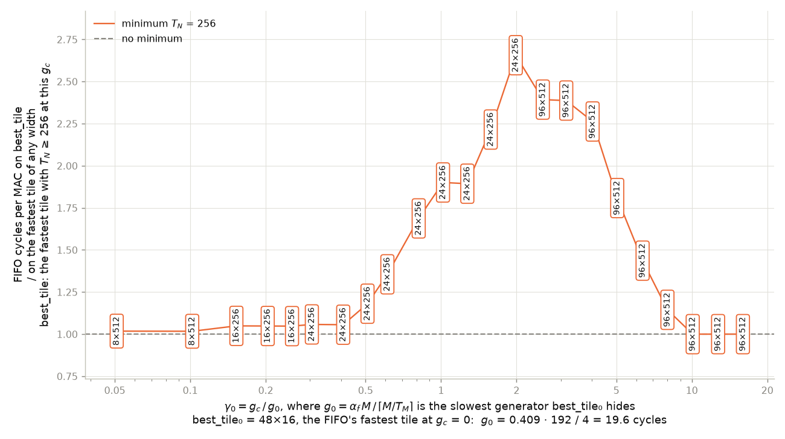
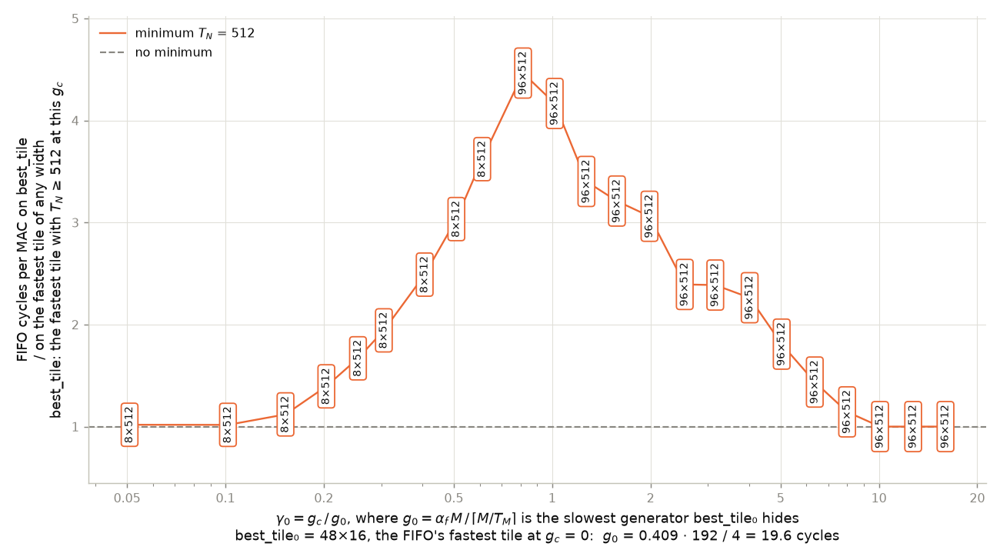

# constraint_tile-v2: composite graphs

Each graph here has γ₀ on its x axis, with the formula in the axis label. A
point that comes from a fastest tile has that tile written in it. The minimum
widths, the working point and the runs are those of the
[main README](../README.md).

γ₀ = g_c / g_0, where g_0 = α_f · M / ⌈M/T_M⌉ on best_tile₀, the FIFO's
fastest tile with a free generator. best_tile₀ is 48×16, so
g_0 = 0.409 · 192 / 4 = 19.6 cycles, the slowest generator that tile keeps up
with.

## The fastest tile of any width

Cycles per MAC on the fastest tile of any width, with the 2 KB FIFO. Every
cost below divides by this. As the generator slows down, the fastest tile
goes through 48×16, 40×32, 48×16, 64×64, 96×32, 96×64 and 96×512.

## What each minimum costs

Cycles per MAC on the fastest tile at least T_N,min wide, over cycles per MAC
on the fastest tile of any width. Each point names the fastest tile the
minimum allows; no_minimum.png names the other. T_N ≥ 16 costs less than 1% at every g_c, so it has no graph.

| minimum | S_min, elements | γ₀ where it costs more than 1% | largest cost | at γ₀ | fastest tile allowed there | fastest tile of any width there |
|---|---|---|---|---|---|---|
| T_N ≥ 32 | 4,096 | 0.81 to 1.02 | 1.08 | 1.02 | 48×128 | 48×16 |
| T_N ≥ 64 | 8,192 | 0.51 to 1.02, 3.16 to 5.04 | 1.38 | 4.02 | 96×64 | 96×32 |
| T_N ≥ 128 | 16,384 | 0.31 to 1.02, 1.58 to 7.99 | 1.99 | 4.02 | 56×128 | 96×32 |
| T_N ≥ 256 | 32,768 | 0.05 to 7.99 | 2.66 | 1.99 | 24×256 | 64×64 |
| T_N ≥ 512 | 65,536 | 0.05 to 7.99 | 4.46 | 0.81 | 96×512 | 48×16 |

Each curve stays at 1 while some tile at least that wide is as fast as the
fastest tile of any width. It rises once the generator is too slow for the
short tiles the minimum allows: a wide tile has to be short to keep A in L1,
and on a short tile each element of B serves few MACs. It comes back to 1 at
large γ₀, where generation sets the time and the 96-row tiles of every
width take the same time. Two of the curves have two bands, because between the bands the minimum allows a tile within 1% of the fastest tile of any width: 48×128, 64×64 and 80×64 for T_N ≥ 64, and 48×128 for T_N ≥ 128.
