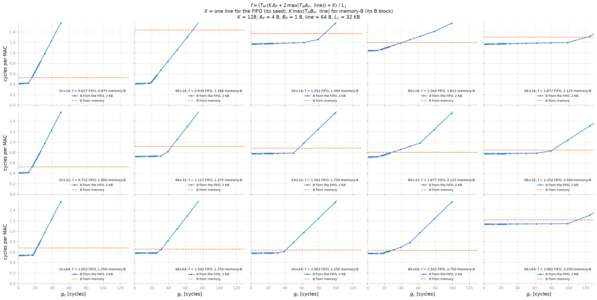
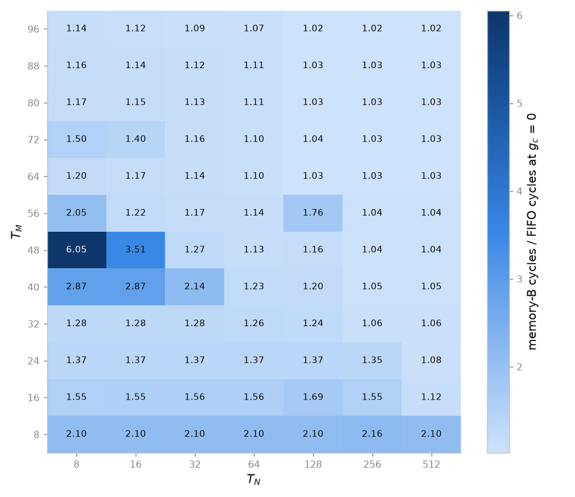
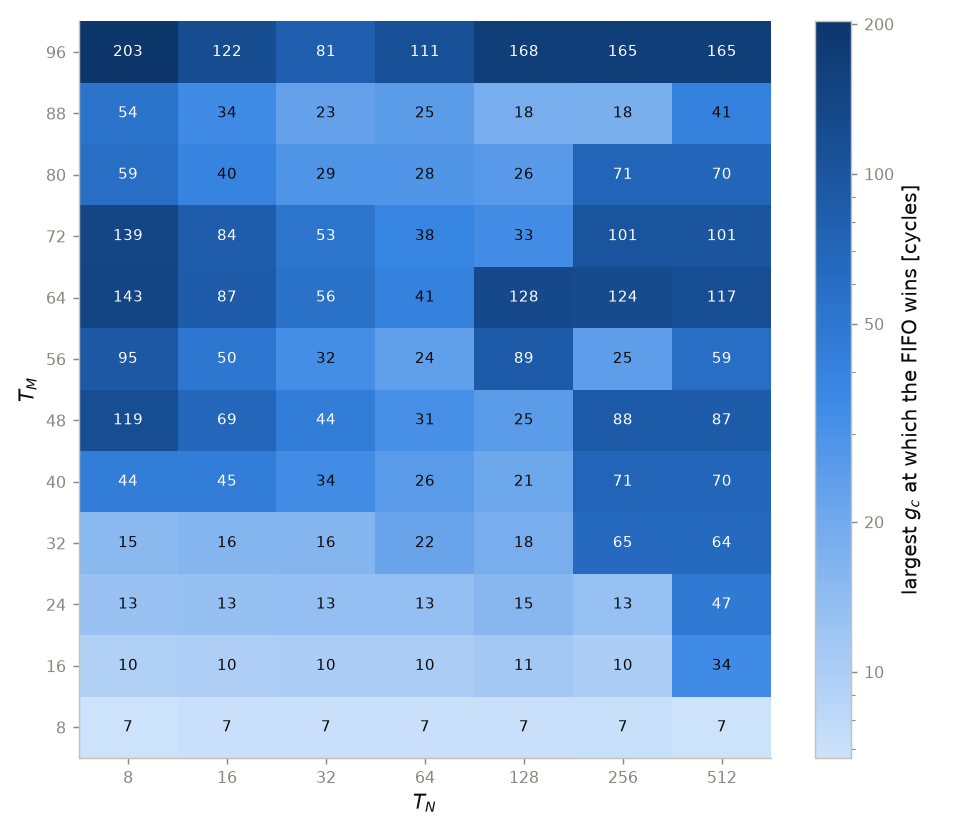
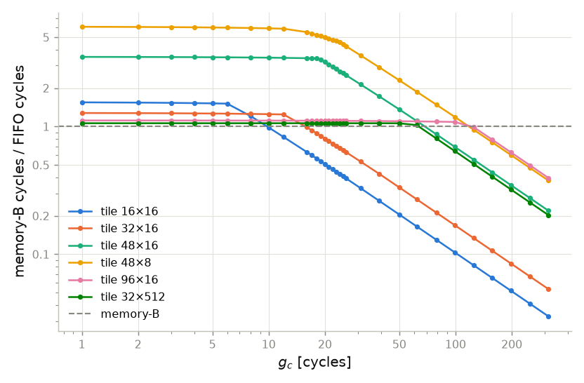
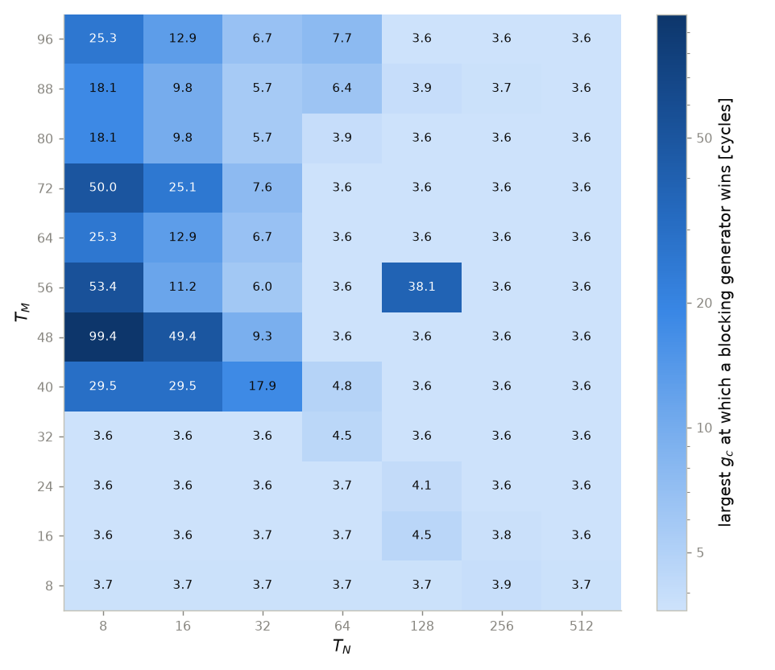
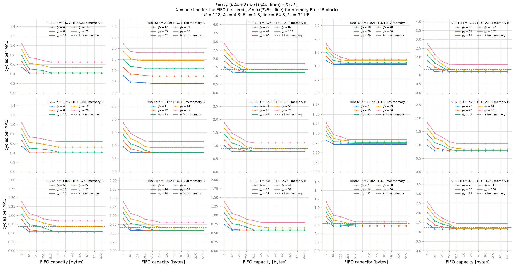

# fifo_feasibility-v2: when does a PRNG FIFO beat loading B from memory?

This experiment runs a B-stationary matmul at one working point modelled on a
256-bit C7x. B comes either from the PRNG FIFO or from DRAM through L1, and A
and C always go through L1. The questions are how slow the generator may be
before loading B is faster, and how deep the FIFO has to be.

run: `.venv/bin/python experiments/rewrite/fifo_feasibility-v2.py`. `constraint_tile-v2.py`
reuses these runs.

## Working point

| parameter | value | source |
|---|---|---|
| A, C | fp32, A_P = 4 bytes | activations |
| B | int8, B_P = 1 byte, stored row by row | weights |
| M, K, N | 192, 128, 512 | small enough that the A band fits L1 for some tiles |
| register block r | 8: one block row of A is 32 bytes, one 256-bit register | |
| cache line | 64 bytes | two registers per line |
| L1 | 32 KB, fully associative, LRU | |
| L2 | none: every L1 miss goes to DRAM, as for operands too big for L2 | |
| t_1 | 5 cycles per L1 hit, one access at a time | |
| t_mem | 200 cycles | |
| a_c | 5 cycles | a pop costs one L1 hit |
| mulacc | 26 cycles per 8×8×8 block (512 MACs) | |
| FIFO | 2048 bytes (2048 elements) | one tile's B block at T_N = 16 |
| seed | 8 bytes per tile, read through L1 | |
| layout | `--aligned` | every row starts on a cache line |
| tiles | T_M = 8 to 96 in steps of 8 (the grid of this experiment), T_N ∈ {8, 16, 32, 64, 128, 256, 512} | 84 tiles |

SPRADC1 describes the 512-bit C71x on the TDA4VM, while r and mulacc are set
for the 256-bit C7504/C7524, so the cache sizes and the core come from
different parts of the family.

## Notation

| symbol | meaning |
|---|---|
| g_c | cycles to generate one element of B |
| t_1, t_mem | L1 hit and DRAM latency, cycles |
| a_c | cycles per FIFO pop; one pop is one r × r block of B |
| T_M, T_N | tile height (rows of A) and width (columns of B); T_K is always K |
| A_P, B_P | bytes per element of A (and C), and of B |
| α | cycles per MAC of a run with g_c = 0: the core's own work (A and C loads, pops, MACs). At the FIFO's best tile 57% of it is L1 hit latency and 30% DRAM misses |
| β | g_c ⌈M/T_M⌉ / M: generation cycles per MAC. B is generated once per tile row, so each element serves T_M MACs. This is the generator's busy time, not added time |
| γ, f | the composite parameters, below |
| α_f(t), α_m(t) | α of tile t with B from the FIFO, and cycles per MAC of tile t with B from memory |
| α_f0 | the FIFO's best α over all tiles |
| α_m* | memory-B's best over all tiles |
| knee | the largest g_c at which a tile within 0.5% of α_f0 still hides the generator: the largest α·M/⌈M/T_M⌉ over those tiles |
| γ₀ | g_c / knee: γ of the tile that sets the knee, with a free generator |
| T_M† | the tallest tile (in rows per tile row) whose α_f still beats α_m* |
| break-even g_c* | α_m* · M / ⌈M/T_M†⌉: past it no tile lets the FIFO beat memory-B. Measured time is never below max(α, β), so this is an upper bound on the measured break-even |
| S | speedup: memory-B's best cycles over the FIFO's best cycles at that g_c |
| S_max | α_m* / α_f0, the speedup while the generator is hidden |
| tie | tiles within 0.5% of the best; the tile named first has the fewest tile rows |

## When the FIFO wins, tile by tile

An engineer thinking of generating B with a PRNG FIFO wants to know three
things about the tile they run: how much faster it gets, how slow the generator
may be before loading B wins again, and how big a FIFO it takes. The first
figure answers them for fifteen tiles, one at a time, and the maps after it
for every tile.
Each graph compares the two
sources of B on the same tile, in cycles, on this machine: no L2, and every
access waits for the one before it. g_c is the generator's cycles per element
of B. The FIFO holds 2 KB and the generator runs in parallel with the core,
unless a graph says otherwise.

### 1. Cycles against g_c, and one rule



Cycles per MAC against g_c, one panel per tile: a row per width, T_N =
16, 32 and 64, and a column per height, T_M = 32, 48, 64, 80 and 96. The solid line
is B from the FIFO and the dashed line is B from memory on the same tile. The
title of each legend names the tile and its f for both sources, from the
formula in the figure's title. With f ≤ 1 the A band stays in L1 for a whole
tile row. Read a panel from left to right. While the generator is fast, the
FIFO line is flat and its gap to memory-B is the win: 1.28 times on 32×16 and
3.51 on 48×16. Then the FIFO line climbs. Where it crosses memory-B's
line is the slowest generator that still wins: 15.8 cycles on 32×16 and
69.0 on 48×16. With a slower generator, load B.

On 32×16, A fits L1 in both modes, so the FIFO saves only B's loads. On
48×16, memory-B's B block pushes A out of L1 while the FIFO's A band still
fits, so memory-B costs 1.44 cycles per MAC there against 0.41. The two
are also the tallest tiles 16 wide that each mode fits in L1. An engineer who
changes tile when they change mode compares the 48×16 FIFO line with the
32×16 memory-B line in the panel to its left: the FIFO wins while g_c is
below 23.7.

On the tiles of the figure where f > 1 for both sources, A is read again in
both modes. Both lines of the panel start high, and the FIFO gains only
1.07 to 1.27 times.

A FIFO line follows one rule:

```
FIFO cycles per MAC ≈ max(core cycles per MAC, g_c / T_M)
```

The core cycles per MAC are the FIFO's time with an instant generator: the
core's own loads of A and C, its pops and its MACs. Each element of B serves
T_M MACs, so generating it costs g_c / T_M cycles per MAC, or exactly
g_c · ⌈M/T_M⌉ / M when T_M doesn't divide M. The FIFO therefore beats memory-B
while

```
g_c < T_M × memory-B cycles per MAC
```

That is 16.8 on 32×16, against 15.8 measured, and 69.0 on
48×16, against 69.0. With the rule, an engineer can redo the decision
for their own tile and their own memory-B number. A generator with no buffer
adds its time to the core's, so it beats memory-B while

```
g_c < T_M × (memory-B cycles per MAC − core cycles per MAC)
```

That is 3.7 on 32×16 and 49.4 on 48×16. On every tile it is
within 1% of the measured limit.

The first rule is a little optimistic. The FIFO restarts empty at every tile,
so near the crossing it loses time the rule doesn't count. On tiles whose T_M
divides M, the measured limit is up to 12% below the rule and
never more than 1% above it. Where T_M doesn't divide M,
the last tile row is short. Its elements of B serve fewer rows, so the
generator falls behind there first, and the limit can be far lower:
18 cycles on 88×128 against 120 by the rule. The 80-row panels of the first figure cross early for the same reason: 40 cycles on 80×16 against 76 by the rule.

### 2. How much the FIFO can win



Memory-B's cycles over the FIFO's on each tile, with a generator that costs
nothing. In the first figure this is the gap between a panel's two flat lines. A real
generator can only lose some of it. The FIFO wins on every tile, by
1.02 to 6.05 times. It saves two things memory-B pays for: loading B,
about 3.7 cycles per element of B in every tile row, and the room B's block
takes in the 32 KB L1.

- Where A fits L1 in both modes, T_M up to 32 here, the FIFO saves only
  B's loads: 2.10 times at T_M = 8 and
  1.28 at T_M = 32. A taller tile loads B fewer
  times per MAC, so there is less to save.
- Where A fits L1 only with the FIFO, it wins most: 2.14 to 6.05
  times on tiles 40 to 48 rows tall and 8, 16 and 32 wide, the most at
  48×8. A row of a B tile narrower than a cache line still takes a
  whole 64-byte line, so memory-B's B block takes K = 128 lines, 8 KB, of
  L1. That pushes its A band out, and memory-B then reads A from DRAM again
  for each of the N / T_N tile columns, 64 of them at T_N = 8. The FIFO keeps
  B out of L1, so its A band still fits.
- Where the C tile overflows L1, on tiles 256 and 512 wide from T_M =
  32 and 16 up, the FIFO gains 2 to 12% at most. The C
  tile, with the two lines of A the core reads next to each of its rows, no
  longer fits in L1. Both modes then read C from DRAM again at every step
  along K, which costs far more than loading B.

### 3. How slow the generator may be



The slowest generator, in cycles per element, at which the FIFO still beats
memory-B on each tile. In the first figure this is where a panel's two lines cross. The
rule puts it at T_M times memory-B's cycles per MAC. Measured, it is
7 cycles at T_M = 8 and
15 to 16 at T_M = 32 where A fits L1 in both
modes, and 34 to 119 where A fits only with the FIFO.

Some wide tiles look good on this map, up to 165 cycles, but
only because both modes are slow there: memory-B's cycles per MAC are high,
so the rule allows a slow generator. The speedup map shows there is almost
nothing to win on them. Read the two maps together: find a tile with a real
gain on the speedup map, then read on this one how fast the generator must
be.

### 4. Between the two maps



Speedup on the same tile as the generator slows down, for six tiles. Each line
starts at its value on the speedup map, stays flat while the generator keeps
up, and falls once it doesn't. It crosses memory-B's line at 1 at its value
on the map of section 3.

| tile | kind of tile | speedup while the generator keeps up | down to 1 at g_c |
|---|---|---|---|
| 16×16 | A fits L1 in both modes | 1.55 | 10 |
| 32×16 | A fits L1 in both modes | 1.28 | 16 |
| 48×16 | A fits L1 only with the FIFO | 3.51 | 69 |
| 48×8 | A fits L1 only with the FIFO | 6.05 | 119 |
| 96×16 | A fits L1 in neither mode | 1.12 | 122 |
| 32×512 | the C tile overflows L1 | 1.06 | 64 |

### 5. A generator that blocks the core



With a FIFO of capacity 0, every pop waits for the generator, as it would for
a software generator running on the core. This map is the second rule,
measured. The generator has to be cheaper than loading B: on 53 of the
84 tiles the limit is 3.6 to 3.9 cycles per element, the cost
of loading one element of B here. That cost is one DRAM access per 64-byte
line of B and one L1 hit per row of an 8×8 block, less the FIFO's pop:
(t_mem + r·t_1 − a_c) / 64 = 3.67 cycles. Where memory-B's B block also
pushes A or C out of L1, the limit is higher, up to 99 at 48×8.
Running the generator in parallel buys the difference between this map and
the map of section 3.

### 6. How big a FIFO



Cycles per MAC against FIFO capacity on the tiles of the first figure, laid
out the same way, with memory-B on the same tile dashed. The title of each
legend names the tile and its f. The lines are at 0.25, 0.5, 0.75, 1 and 1.25 times the tile's
limit from the first figure, so each panel runs from a generator well ahead
of the core to one that loses. Capacity 0, the first point of each line, is
a generator with no buffer. A line flattens at the capacity its g_c needs.
The most any of a tile's five lines needs, as the smallest capacity within
1% of 64 KB:

| T_N | T_M = 32 | T_M = 48 | T_M = 64 | T_M = 80 | T_M = 96 |
|---|---|---|---|---|---|
| 16 | 512 B | 512 B | 512 B | 256 B | 512 B |
| 32 | 1024 B | 512 B | 1024 B | 512 B | 1024 B |
| 64 | 1024 B | 2048 B | 2048 B | 1024 B | 512 B |

### Summary

- The FIFO wins while g_c < T_M × memory-B cycles per MAC, a little less near
  the crossing and much less when T_M doesn't divide M. Well below that limit,
  it is memory-B / core cycles per MAC times faster.
- It gains most where it frees L1. On tiles 40 to 48 rows tall and
  8, 16 and 32 wide, memory-B's B block pushes A out of L1, and the FIFO is
  2.14 to 6.05 times faster with a generator as slow as
  34 to 119 cycles per element.
- Where A fits L1 either way, the FIFO is 1.28 to 2.10 times faster
  as long as the generator makes an element in under 7 to 16 cycles.
  Taller tiles allow slower generators.
- Where the C tile overflows L1, keep loading B: the FIFO gains
  2 to 12% there whatever the generator.
- A generator that blocks the core must beat 3.7 cycles per element on most
  tiles, the cost of loading one.
- 2048 bytes of FIFO is enough on every tile of the first figure, at every
  g_c shown.

## Changes from the first version

The first version is `fifo_feasibility.py`, with its outputs in
`out/fifo_feasibility/`; both are unchanged. A review of it found the numbers
right and several explanations wrong or too strong. This version:

- counts in f everything that has to stay in L1 for a tile row: the seed line
  for the FIFO, the B block for memory-B. The limit is f ≤ 1 on both sides,
  and the FIFO's limit at T_N = 64 is 24 (32×64 spills because of the seed);
- takes the knee from all tiles within 0.5% of α_f0, so a near-tie can't move
  it, and reports tiles within 0.5% of each other as ties, naming the one
  with the fewest tile rows;
- says which agreement in the collapse holds by construction, gives the
  statistics inside 0.5 ≤ γ ≤ 2, and explains the excess there tile by tile;
- adds α against f, here and in model_sweep (the fill section);
- compares the FIFO and memory-B on the same tile, in cycles against g_c
  (the tile section);
- measures the break-even on a finer g_c grid, next to the max model's;
- measures depth at several generator costs up to a FIFO that never fills, and
  traces the burst at the start of a tile to the k = 0 read of C;
- adds a sensitivity table (faster L1 hits, no DRAM latency, memory-B
  without B's misses, packed B) and states the simulator issues with numbers;
- runs N = 512 with tiles up to 512 wide, where the first version ran N = 256.

## Composite parameters

Two composites carry the results. α is measured (a run at g_c = 0); β is computed from g_c, M and T_M; f from the tile and cache sizes.

| composite | definition | what it decides |
|---|---|---|
| γ | β / α | γ < 1: the generator keeps up and is hidden, time ≈ α, if the FIFO is deep enough (depth section). γ > 1: the generator is the bottleneck, time ≈ β. Near γ = 1 the time is above both, by an amount the max model doesn't see |
| f | what has to stay in L1 for a whole tile row, over L1: T_M·(K·A_P + 2·max(T_N·A_P, line)), plus one line for the FIFO's seed or K·max(T_N·B_P, line) for memory-B's B block | f ≤ 1: the A band survives the tile row and α stays at its best. Past 1, A is read again for every tile column, and α jumps by an amount that grows with the number of tile columns N/T_N |

f has a companion inside a tile, the tile limit T_M·(max(T_N·A_P, line) + 2·line) ≤ L1: between two k steps the core walks the whole C tile and two k-columns of A, and past the limit C is read from DRAM again inside the tile.

### γ: every run lies between two curves

All 25,536 runs with a generator lie in the band
between two curves of γ. The lower edge, max(1, γ), is a generator
running in parallel with the core with nothing else lost; no run can be
faster, since neither the core's work nor the generation shrinks. The upper
edge, 1 + γ, is generation blocking the core. The capacity-0 runs land on it
by construction, because every pop then stalls g_c per missing element and the
cache doesn't depend on time (largest deviation 0.00%).
None of the 22,932 parallel runs
is outside the band, so the two curves
are bounds that hold for every run. The composites have to explain where
between them the parallel runs fall.

Away from γ = 1 most of them sit on the lower edge. Inside 0.5 ≤ γ ≤ 2 they
spread upward, and that is the range that decides the comparison with memory-B: at
this working point the FIFO only wins below γ₀ = 1.21.

| runs with a generator in parallel | 0.5 ≤ γ ≤ 2 | runs | median above max(α, β) | within 1% | more than 5% above |
|---|---|---|---|---|---|
| model_sweep | inside | 4845 | 0.73% | 54% | 23% |
| model_sweep | outside | 15483 | 0.05% | 90% | 3% |
| this working point, 2 KB | inside | 694 | 1.94% | 44% | 34% |
| this working point, 2 KB | outside | 1910 | 0.11% | 83% | 5% |

The time above max(α, β) near γ = 1 comes from tiles that are not alike, and
from the FIFO starting empty at every tile. Tile 48×16 at the knee
shows it:

| tile 48×16 at g_c = 20 | cycles |
|---|---|
| core work of the first tile of a tile row (g_c = 0) | 114,647, tile γ = 0.36 |
| core work of each of the 31 later tiles | 37,797, tile γ = 1.08 |
| generating one tile's B block, K·T_N·g_c | 40,960 |
| measured, whole run, 2 KB FIFO | 5,656,976 |
| sum over tiles of the slower of core and generator | 5,651,992 (-0.09%) |
| max(α, β) · M·N·K | 5,242,880 (-7.3%) |

The first tile of each tile row reads the A band from DRAM, so its core work
takes 114,647 cycles while generating its B block takes
40,960: the generator finishes early and the FIFO fills. The 31
later tiles find the band in L1 and need only 37,797 cycles of
core work, less than the generation, so they wait for the generator. The FIFO
is emptied at the start of every tile, so the time the generator had to spare
in the first tile is lost. Summing, tile by tile, the slower of the core
(plus the wait for the first block, r²·g_c) and the generator (plus the work
after the last pop) gives the measured time within
0.1%. max(α, β) averages over the
tiles first and comes out 7% low.

48×128 at the same g_c has f = 2.25, so A is read again in every
tile and all 4 tiles of a tile row do the same work (379,341
cycles of core work against 327,680 of generation, tile γ
0.86). The generator is hidden in every tile,
and the measured time is 0.3% above
max(α, β). It is still slower than 48×16 there, 0.4840 against 0.4496 cycles per MAC: reading A again for each of its 4 tile columns makes its α 0.482 against 0.409. At g_c =
25 (tile γ 1.08) the 2 KB FIFO leaves
48×128 6.6% above max(α, β), and
a 4 KB FIFO brings it to 0.3%.
That loss is inside the tile: the core is slow while it takes the C misses at
the start, and 2 KB can't bank enough generation during that stretch (see the
depth section).

Outside the band, 479 of the 15,483 model_sweep runs are more than
5% above max(α, β). 91% of them have a
last tile row shorter than half of T_M, such as M = 100 with T_M = 96: in that
row each B element serves only a few MACs, so the generator is the bottleneck
there even when γ over the whole run is small. Taking the max separately for
each tile row brings the worst of them (γ = 0.47,
1.23 times max(α, β)) to 1.03 times;
the largest that remains among these runs is 1.19 times.

model_sweep's runs are read from its cache, written by build 9cdda6f.
24 of 24 of them, picked at random and run again with
the current build (90a7365), give the same stats. Its FIFO holds
2·K·64 elements of 4 bytes (50 to 256 KB), more than a tile's B block, so it
never fills.

### f: where the L1 limit falls

f is the part of L1 that has to hold data for a whole tile row: the A band
and two C tiles, plus the seed line for the FIFO or the B block for memory-B.
With B from the FIFO, with B from memory and in model_sweep, α stays at the
best value of its tile column while f ≤ 1 and rises once f passes 1. model_sweep runs a different device (4-byte elements,
r = 4, L1 of 8, 16 and 32 KB, rows not padded to cache lines) on six matrix
shapes. Its rows don't always start on a line, so a C tile row can straddle
one line more than its width needs, and f counts that line. In the
133 tile columns that have tiles on both sides of f = 1, no tile with
f ≤ 1 is more than 3.2% above the best of its column, and the
first tile more than 5% above it sits at f = 1.03 to
1.80 (median 1.25). How far past 1
depends on how big a step the next T_M of the grid is.

f tells where α jumps. How far it jumps depends on the number of tile
columns, N/T_N, because past f = 1 the A band is read again for each of them:
at this working point α grows 2.59
times at T_N = 8 (64 tile columns) and 1.03
times at T_N = 256 (two). Memory-B at T_N = 128 even gets cheaper past its limit, because taller tiles also load B fewer times. Past the tile limit,
T_M · (max(T_N·A_P, line) + 2·line) > L1, C doesn't survive from one k step
to the next. That limit causes the large jumps at 88×64, 56×128 and 32×256 and is
the only limit at T_N = 512 (one tile column, not drawn).

## Calibration

| quantity | value |
|---|---|
| α_f0, the FIFO's best tile | 0.4092 at 48×16 (f = 0.94); 10 more tiles within 0.5%, the closest 48×8 |
| α_m*, memory-B's best tile | 0.5244, an exact tie of 32×8 (f = 0.88), 32×16 (f = 0.88), 32×32 (f = 1.00) |
| S_max = α_m* / α_f0 | 1.282 |
| knee | g_c = 19.7, from 48×8 (α = 0.4095, 4 tile rows) |
| T_M† | 48 (tile 48×16, α_f = 0.4092, 4 tile rows) |
| predicted break-even g_c* | 25.2, γ₀ = 1.28 |

With a free generator the core costs about 0.409 cycles per MAC on
every tile until the A band stops fitting in L1: 11 tiles are within
0.5% of the best. That α is mostly waiting on memory. At 48×16 it
splits into 0.234 for L1 hits
(57%), 0.122 for DRAM misses
(30%), 0.051 for the MACs and
0.002 for pops, because the simulator charges every access its
full latency, one after another.

Memory-B costs more on every tile. Its B loads take L1 hits and DRAM misses,
and its B block takes K whole lines of L1, so its band stops fitting at a
smaller T_M. The limit rows under the tables give the tallest T_M with f ≤ 1,
where f counts the seed line for the FIFO and the B block for memory-B. For
the FIFO the first jump of more than 3% in every column with several tile
columns is at the next T_M past that limit. For memory-B it is too, except at T_N = 128: with only 4 tile columns, reading A again costs less than taller tiles save by loading B fewer times, so α keeps falling past the limit. At T_N = 256 memory-B has no such tile: its B block alone, K rows of T_N bytes, fills L1.

How much the jump past f = 1 costs depends on how many tile columns read A
again: with T_N = 8 there are 64, and α grows 2.59 times; with
T_N = 256 there are two, and α rises by only 3% to
4%. Within the T_N = 64, 128 and 256 columns the largest
jumps come from the tile limit (88×64: 1.61 times, 56×128: 2.17 times, 32×256: 4.36 times).
Between two k steps the core walks the whole C tile and two k-columns of A,
so T_M · (max(T_N·A_P, line) + 2·line) has to fit in L1, or C is read from
DRAM again during the tile. At T_N = N = 512 there is a single tile column,
the band is never reused, and the tile limit is the only one.

T_M† is 48, the height of the FIFO's best tile. Taller tiles cost
0.56 to 0.77 cycles per MAC because their band no
longer fits, which is more than memory-B's best. So when the generator becomes
the bottleneck the FIFO has no taller tile to move to, and the predicted
break-even is only 1.28 times the knee.

Cycles per MAC with B from the FIFO at g_c = 0 (α_f):

| T_M | T_N = 8 | T_N = 16 | T_N = 32 | T_N = 64 | T_N = 128 | T_N = 256 | T_N = 512 |
|---|---|---|---|---|---|---|---|
| 8 | 0.418 | 0.417 | 0.417 | 0.417 | 0.417 | 0.417 | 0.417 |
| 16 | 0.414 | 0.413 | 0.412 | 0.412 | 0.412 | 0.430 | 1.877 |
| 24 | 0.412 | 0.411 | 0.411 | 0.411 | 0.465 | 0.435 | 1.875 |
| 32 | 0.411 | 0.410 | 0.410 | 0.538 | 0.483 | 1.899 | 1.875 |
| 40 | 0.410 | 0.410 | 0.409 | 0.548 | 0.483 | 1.899 | 1.874 |
| 48 | 0.409 | 0.409 | 0.722 | 0.580 | 0.482 | 1.898 | 1.874 |
| 56 | 1.060 | 1.060 | 0.730 | 0.559 | 1.046 | 1.715 | 1.874 |
| 64 | 1.950 | 1.167 | 0.775 | 0.580 | 1.947 | 1.898 | 1.873 |
| 72 | 1.564 | 0.977 | 0.762 | 0.580 | 1.581 | 1.898 | 1.873 |
| 80 | 1.692 | 1.040 | 0.714 | 0.573 | 1.703 | 1.898 | 1.873 |
| 88 | 1.821 | 1.103 | 0.745 | 0.921 | 1.819 | 1.775 | 1.873 |
| 96 | 1.948 | 1.166 | 0.775 | 1.135 | 1.946 | 1.897 | 1.873 |
| tallest T_M with f ≤ 1 (A band, two C tiles, seed line) | 48 | 48 | 40 | 24 | 16 | 8 | one tile column |
| tallest T_M inside the tile limit | 96 | 96 | 96 | 80 | 48 | 24 | 8 |

Cycles per MAC with B from memory (α_m):

| T_M | T_N = 8 | T_N = 16 | T_N = 32 | T_N = 64 | T_N = 128 | T_N = 256 | T_N = 512 |
|---|---|---|---|---|---|---|---|
| 8 | 0.876 | 0.876 | 0.876 | 0.876 | 0.876 | 0.900 | 0.876 |
| 16 | 0.642 | 0.642 | 0.642 | 0.642 | 0.697 | 0.666 | 2.106 |
| 24 | 0.563 | 0.563 | 0.563 | 0.563 | 0.637 | 0.588 | 2.028 |
| 32 | 0.524 | 0.524 | 0.524 | 0.679 | 0.598 | 2.014 | 1.989 |
| 40 | 1.177 | 1.177 | 0.875 | 0.673 | 0.578 | 1.994 | 1.970 |
| 48 | 2.479 | 1.438 | 0.917 | 0.656 | 0.559 | 1.975 | 1.950 |
| 56 | 2.173 | 1.294 | 0.855 | 0.635 | 1.840 | 1.792 | 1.950 |
| 64 | 2.346 | 1.369 | 0.881 | 0.637 | 2.004 | 1.955 | 1.931 |
| 72 | 2.346 | 1.369 | 0.881 | 0.637 | 1.638 | 1.955 | 1.931 |
| 80 | 1.975 | 1.194 | 0.804 | 0.634 | 1.760 | 1.955 | 1.931 |
| 88 | 2.104 | 1.257 | 0.834 | 1.021 | 1.880 | 1.833 | 1.931 |
| 96 | 2.212 | 1.301 | 0.845 | 1.215 | 1.984 | 1.936 | 1.911 |
| tallest T_M with f ≤ 1 (A band, two C tiles, B block) | 32 | 32 | 32 | 24 | 8 | none | one tile column |
| tallest T_M inside the tile limit | 96 | 96 | 96 | 80 | 48 | 24 | 8 |

## Generator sweep

| | max model | measured |
|---|---|---|
| break-even, 2 KB FIFO | g_c = 25.2 (γ₀ = 1.28) | g_c = 23.7 (γ₀ = 1.21) |
| break-even, capacity 0 | g_c = 5.5 | g_c = 5.5 (the same by construction) |
| largest gap between measured and predicted speedup, 2 KB | | 7.3% at g_c = 20 (γ₀ = 1.02) |

Below the knee the generator is hidden and the speedup stays close to S_max =
1.282. It is within 1% of the prediction up to γ₀ = 0.41
and then starts to fall below it (1.1% at γ₀ = 0.51, 1.2% at γ₀ = 0.61, 2.5% at γ₀ = 0.81), because the tiles are not
alike (see the worked example under the composites). Near the knee the
measurement is furthest below the prediction, 7.3% at γ₀ =
1.02.

The measured break-even is g_c = 23.7 (γ₀ = 1.21),
below the 25.2 the max model predicts. No run is faster than
max(α, β), so the predicted break-even is an upper bound for any FIFO depth;
the depth section shows how close a deeper FIFO gets. Past the break-even the
FIFO moves to taller tiles (64×64, then 96×32), but their α is
already above memory-B's best, so the speedup stays below 1 and the max model
follows the measurements closely again.

With capacity 0 the generator blocks the core, so the time is α + β by
construction, and the break-even, g_c = 5.5, is where β
equals what loading B costs at the FIFO's best tile: α_m* − α_f =
0.115 cycles per MAC, times the 48 MACs each
element serves, 5.5 cycles per element.
Generating in parallel with the core tolerates a generator
4.3 times slower.

In bytes, the measured break-even is one int8 element every 24
cycles, about 42 MB/s at 1 GHz. Like the knee, that figure
scales with α, which at this working point is mostly access latency paid one
access at a time (see the sensitivity section).

Every point. The g_c from 17 to 26 are a finer grid around the break-even; tied tiles are within 0.5% of the best:

| g_c | γ₀ | S max model | S measured, 2 KB | best tile, 2 KB | S max model, capacity 0 | S measured, capacity 0 |
|---|---|---|---|---|---|---|
| 1 | 0.05 | 1.282 | 1.280 | 48×16 (tied: 48×8, 40×32 and 6 more) | 1.220 | 1.220 |
| 2 | 0.10 | 1.282 | 1.278 | 48×16 (tied: 48×8, 40×32 and 5 more) | 1.163 | 1.163 |
| 3 | 0.15 | 1.282 | 1.277 | 48×16 (tied: 40×32, 40×16 and 2 more) | 1.112 | 1.112 |
| 4 | 0.20 | 1.282 | 1.276 | 48×16 (tied: 40×32, 40×16 and 3 more) | 1.065 | 1.065 |
| 5 | 0.25 | 1.282 | 1.274 | 48×16 (tied: 40×32, 32×32 and 2 more) | 1.022 | 1.022 |
| 6 | 0.31 | 1.282 | 1.273 | 48×16 (tied: 40×32, 32×32 and 1 more) | 0.982 | 0.982 |
| 8 | 0.41 | 1.282 | 1.271 | 48×16 (tied: 40×32, 32×32 and 1 more) | 0.911 | 0.911 |
| 10 | 0.51 | 1.282 | 1.268 | 40×32 (tied: 32×32) | 0.849 | 0.849 |
| 12 | 0.61 | 1.282 | 1.266 | 40×32 (tied: 32×32) | 0.796 | 0.796 |
| 16 | 0.81 | 1.282 | 1.250 | 48×16 | 0.706 | 0.706 |
| 17 | 0.86 | 1.282 | 1.248 | 48×16 | 0.687 | 0.687 |
| 18 | 0.92 | 1.282 | 1.246 | 48×16 | 0.669 | 0.669 |
| 19 | 0.97 | 1.282 | 1.221 | 48×16 | 0.651 | 0.651 |
| 20 | 1.02 | 1.259 | 1.166 | 48×16 | 0.635 | 0.635 |
| 21 | 1.07 | 1.199 | 1.116 | 48×16 | 0.619 | 0.619 |
| 22 | 1.12 | 1.144 | 1.070 | 48×16 | 0.605 | 0.605 |
| 23 | 1.17 | 1.094 | 1.028 | 48×16 | 0.590 | 0.590 |
| 24 | 1.22 | 1.049 | 0.989 | 48×16 | 0.577 | 0.577 |
| 25 | 1.27 | 1.007 | 0.952 | 48×16 | 0.564 | 0.564 |
| 26 | 1.32 | 0.968 | 0.919 | 48×16 (tied: 48×128) | 0.552 | 0.552 |
| 31 | 1.58 | 0.916 | 0.899 | 64×64 | 0.497 | 0.497 |
| 39 | 1.98 | 0.861 | 0.857 | 64×64 | 0.444 | 0.444 |
| 50 | 2.54 | 0.677 | 0.670 | 96×32 (tied: 80×64, 64×64 and 1 more) | 0.405 | 0.405 |
| 62 | 3.15 | 0.677 | 0.668 | 96×32 | 0.369 | 0.369 |
| 79 | 4.02 | 0.637 | 0.633 | 96×32 | 0.328 | 0.328 |
| 99 | 5.04 | 0.509 | 0.506 | 96×32 | 0.290 | 0.290 |
| 125 | 6.36 | 0.403 | 0.402 | 96×64 (tied: 96×32) | 0.253 | 0.253 |
| 157 | 7.99 | 0.321 | 0.320 | 96×64 (tied: 96×32, 96×16) | 0.218 | 0.218 |
| 198 | 10.07 | 0.254 | 0.254 | 96×512 (tied: 96×64, 96×256 and 3 more) | 0.185 | 0.185 |
| 250 | 12.72 | 0.201 | 0.201 | 96×512 (tied: 96×256, 96×64 and 3 more) | 0.155 | 0.155 |
| 314 | 15.98 | 0.160 | 0.160 | 96×512 (tied: 96×256, 96×128 and 3 more) | 0.130 | 0.130 |

## FIFO depth

| g_c | γ₀ | FIFO that never fills: cycles per MAC, tile | smallest capacity within 1% of it | smallest capacity faster than memory-B | 2 KB FIFO |
|---|---|---|---|---|---|
| 4 | 0.20 | 0.4111, 48×16 (tied: 40×32, 40×16 and 3 more) | 64 B | 0 B | 0.4111 |
| 5 | 0.25 | 0.4115, 48×16 (tied: 40×32, 32×32 and 2 more) | 64 B | 0 B | 0.4115 |
| 6 | 0.31 | 0.4119, 48×16 (tied: 40×32, 32×32 and 2 more) | 64 B | 64 B | 0.4119 |
| 8 | 0.41 | 0.4127, 48×16 (tied: 40×32, 32×32 and 1 more) | 64 B | 64 B | 0.4127 |
| 10 | 0.51 | 0.4135, 40×32 (tied: 32×32) | 64 B | 64 B | 0.4135 |
| 12 | 0.61 | 0.4143, 40×32 (tied: 32×32) | 64 B | 64 B | 0.4143 |
| 16 | 0.81 | 0.4196, 48×16 | 512 B | 64 B | 0.4196 |
| 20 | 1.02 | 0.4496, 48×16 | 512 B | 256 B | 0.4496 |
| 25 | 1.27 | 0.5222, 48×128 | 4096 B | 4096 B | 0.5506 |
| 31 | 1.58 | 0.5835, 64×64 | 512 B | none | 0.5835 |
| 39 | 1.98 | 0.6120, 64×64 | 2048 B | none | 0.6120 |
| 50 | 2.54 | 0.7829, 96×32 (tied: 80×64, 64×64 and 1 more) | 256 B | none | 0.7829 |

How deep the FIFO has to be depends on γ₀. Up to γ₀ = 0.61
(g_c = 12) one pop, 64 bytes, is within 1% of a FIFO that never fills:
the generator refills a block long before the core asks for the next one.
Closer to the knee the need grows: 512 bytes at γ₀ =
0.81, 512 bytes at the knee, where the 2 KB FIFO
is as fast as one that never fills, and 4 KB at g_c = 25. At g_c = 25, the max model's break-even, the 2 KB FIFO loses to
memory-B and 4 KB wins; 4 KB or more comes within
0.3% of the max model's bound there, max(α, β) =
0.5208. Past the break-even no capacity beats memory-B, and the depth
needed for 1% goes up and down with the tile the FIFO picks.

The depth needed near the knee is set by the start of each tile. The FIFO
starts empty there, and in the first k step the core reads every line of the
C tile for the first time: the loop loads C before it accumulates into it,
and each of those read misses blocks the core for t_mem. While the core
waits, the generator makes T_M · ⌈T_N·A_P / line⌉ · (t_mem + t_1) / g_c
elements. A smaller FIFO fills up and the generator idles, and later in the
tile, where the core is faster than the generator, the core stalls for the
lead it could not bank. The table at the end runs capacities from half to
twice that burst for tiles 48×16 and 48×128. Where the tile's γ is 1
or more, the time stops falling (stays within 0.5% of its value at twice the
burst) at 1.10 times the burst for 48×16 at g_c = 20, 1.10 times the burst for 48×16 at g_c = 25 and 1.00 times the burst for 48×128 at g_c = 25. Where γ is below 1 it stops earlier, at 0.50 times the burst for 48×128 at g_c = 20, because
the generator is faster than the core for the rest of the tile and part of
the lead is never needed. A kernel computing C = A·B would zero its
accumulators instead of loading C, and a core with misses in flight would not
wait for each line in turn, so this burst comes from the simulator's model
(see simulator issues).

Every capacity at the knee (g_c = 20) and at the max model's break-even (g_c = 25): cycles per MAC, best tile, share of time stalled. Memory-B's best is 0.5244.

| capacity, bytes | g_c = 20 | g_c = 25 |
|---|---|---|
| 0 | 0.8258, 48×16 (tied: 48×8), 50% | 0.9300, 48×16 (tied: 48×8), 56% |
| 64 | 0.5432, 48×16, 25% | 0.6433, 48×16, 36% |
| 128 | 0.5276, 48×16, 22% | 0.6236, 48×16, 34% |
| 256 | 0.5024, 48×16, 19% | 0.5907, 48×16, 31% |
| 512 | 0.4519, 48×16, 9% | 0.5506, 48×16, 26% |
| 1024 | 0.4496, 48×16, 9% | 0.5506, 48×16, 26% |
| 2048 | 0.4496, 48×16, 9% | 0.5506, 48×16, 26% |
| 4096 | 0.4496, 48×16, 9% | 0.5222, 48×128, 8% |
| 8192 | 0.4496, 48×16, 9% | 0.5222, 48×128, 8% |
| 16384 | 0.4496, 48×16, 9% | 0.5222, 48×128, 8% |
| 32768 | 0.4496, 48×16, 9% | 0.5222, 48×128, 8% |
| 65536 | 0.4496, 48×16, 9% | 0.5222, 48×128, 8% |

Fixed tile, capacity as a multiple of the burst (cycles per MAC):

| tile | g_c | γ of the tile | burst, elements | × 0.5 | × 0.75 | × 0.9 | × 1 | × 1.1 | × 1.25 | × 1.5 | × 2 |
|---|---|---|---|---|---|---|---|---|---|---|---|
| 48×16 | 20 | 1.02 | 492 | 0.5044 | 0.4801 | 0.4655 | 0.4559 | 0.4496 | 0.4496 | 0.4496 | 0.4496 |
| 48×16 | 25 | 1.27 | 394 | 0.6053 | 0.5811 | 0.5666 | 0.5567 | 0.5506 | 0.5506 | 0.5506 | 0.5506 |
| 48×128 | 20 | 0.86 | 3936 | 0.4840 | 0.4840 | 0.4840 | 0.4840 | 0.4840 | 0.4840 | 0.4840 | 0.4840 |
| 48×128 | 25 | 1.08 | 3149 | 0.5703 | 0.5453 | 0.5303 | 0.5222 | 0.5222 | 0.5222 | 0.5222 | 0.5222 |

## How much the answer depends on the model

| change | α_f0, tile | α_m*, tile | S_max | knee g_c | T_M† | break-even g_c*, max model (γ₀) | break-even, measured 2 KB (γ₀) |
|---|---|---|---|---|---|---|---|
| the working point | 0.4092, 48×16 | 0.5244, 32×8 (tied: 32×16 and 1 more) | 1.282 | 19.7 | 48 | 25.2 (1.28) | 23.7 (1.21) |
| L1 hit and pop in 1 cycle | 0.2203, 48×16 | 0.3213, 32×8 (tied: 32×16 and 1 more) | 1.458 | 10.6 | 48 | 15.4 (1.46) | not run |
| no DRAM latency (t_mem = 0) | 0.2860, 96×512 | 0.2917, 96×8 (tied: 96×16 and 5 more) | 1.020 | 27.5 | 96 | 28.0 (1.02) | not run |
| memory-B with B's own misses free (B still takes room in L1) | 0.4092, 48×16 | 0.4268, 32×8 (tied: 32×16 and 1 more) | 1.043 | 19.7 | 48 | 20.5 (1.04) | 18.7 (0.95) |
| memory-B with B packed in r × r blocks (Python model) | 0.4092, 48×16 | 0.4740, 48×8 (tied: 48×16) | 1.158 | 19.7 | 48 | 22.8 (1.16) | 21.2 (1.08) |

Every number in the sections above holds for this model of the machine: no
L2, every access paying its full latency before the next one starts, and B
stored row by row. The table repeats the calibration with one latency
changed at a time. The last two rows keep this working point's runs and
change only memory-B: one frees B's own misses, the other stores B in packed
blocks.

Without DRAM latency (t_mem = 0) S_max is 1.020,
so almost all of the FIFO's lead at this working point is DRAM latency, and
most of that is B's own. With only B's own misses free, memory-B's best is
0.4268 at 32×8 (tied: 32×16 and 1 more),
S_max = 1.043, and against the measured 2 KB sweep the FIFO breaks
even at g_c ≈ 18.7, below the knee. That row still keeps
B's lines in L1, which caps memory-B at T_M = 32. If B
also stayed out of L1, as it does when the C7x's streaming engines read it
past L1D, memory-B could use the FIFO's tall tiles; freeing every miss
memory-B takes beyond the FIFO's gives S_max = 1.028.
Storing B in packed 8×8 blocks of one
line each gives memory-B fewer L1 accesses and a B block of K·T_N bytes
instead of K lines, so it can use the same tall tiles as the FIFO: its best is
0.4740 at 48×8 (tied: 48×16), S_max drops to
1.158 and the measured break-even to g_c ≈ 21.2, about the
knee. build/sim has no packed layout, so this row comes from a Python copy of
its loop (`memory_b_python`), which reproduces build/sim's memory-B cycles
exactly on all 84 tiles of the row-major layout.

With 1-cycle L1 hits and pops, α_f0 shrinks to 0.220, S_max rises
to 1.46 and the knee falls from
19.7 to 10.6. Every absolute g_c above (knee,
break-even, the MB/s figure) assumes 5-cycle accesses taken one at a time.

So the FIFO's lead at this working point, 28%
while the generator is hidden, depends on the model. With B's own misses
hidden or B packed it is 4% to 16%, and it lasts
only up to about the knee.

## Simulator issues these runs expose

- Every cache access stalls the core until it completes, misses are taken one
  at a time, and nothing streams or prefetches B. At memory-B's best tile
  (32×8) memory-B costs 0.1138 cycles per MAC more than the
  FIFO with a free generator. 0.0969 of it is DRAM latency for the
  6,096 misses it takes beyond the FIFO's: B's 1024 lines, missed
  again in each of the 6 tile rows (6,144), less
  48 misses the FIFO takes on its seeds. 0.0194 is L1 hits
  for B's loads, and the FIFO's pops give 0.0024 back. A C7x streams B
  with its streaming engines. With B's own misses free, S_max is
  1.043 and the FIFO breaks even
  below the knee (previous section). A and C misses block the core the same
  way: they are 30% of α_f0.
- L1 hits are charged one after another too: 57% of α_f0
  is L1 hit latency, 24 accesses of 5 cycles per 512 MACs.
  The C7x's two load/store units pipeline their loads (SPRADC1 Fig. 2-5).
  With 1-cycle hits the knee falls from 19.7 to 10.6.
- C is read before it is computed. In the first k step the loop loads every
  block of the C tile (`load_into_reg(c, ...)` in `MultiUnit::reg_weight_mul`),
  so each tile starts with a read miss on every line of its C tile, taken one
  at a time. A kernel computing C = A·B would zero its accumulators. This
  burst is what sets the FIFO depth needed near the knee.
- The FIFO starts empty at every tile (`PrngFifo::load_seed`). Each tile waits
  r²·g_c for its first B block, and the lead the generator builds while the
  core is slow in one tile can't carry into the next. Near γ = 1 this is most
  of the time above max(α, β) (worked example in the composites section). The
  next tile's seed is at a fixed address, so a generator could start on it
  early.
- B is stored row by row. An 8×8 block of int8 B then spans 8 lines and
  takes 8 L1 accesses, and a B tile narrower than a line still takes K whole
  lines of L1, which caps memory-B at T_M = 32.
  Deployed int8 weights are usually packed in the order the kernel reads
  them; the previous section estimates that case
  (S_max 1.158).
- The seed is read through L1 at the start of every tile. At 32×64 that one
  line is what pushes the A band out: f is 1.002 with it and
  1.000 without.
- g_c is a whole number of cycles. Near the knee one cycle is a
  5% step, and a generator faster than one element per cycle
  can't be set without scaling every other latency.
- T_K is always K, so the A band is a full row of K elements. With K in the
  thousands, as in real layers, no tile would fit L1. K = 128 keeps the L1
  limit inside the range of T_M swept here.
