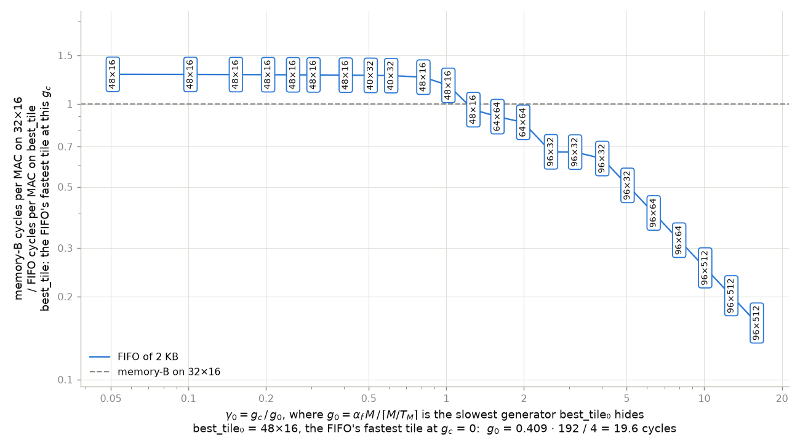
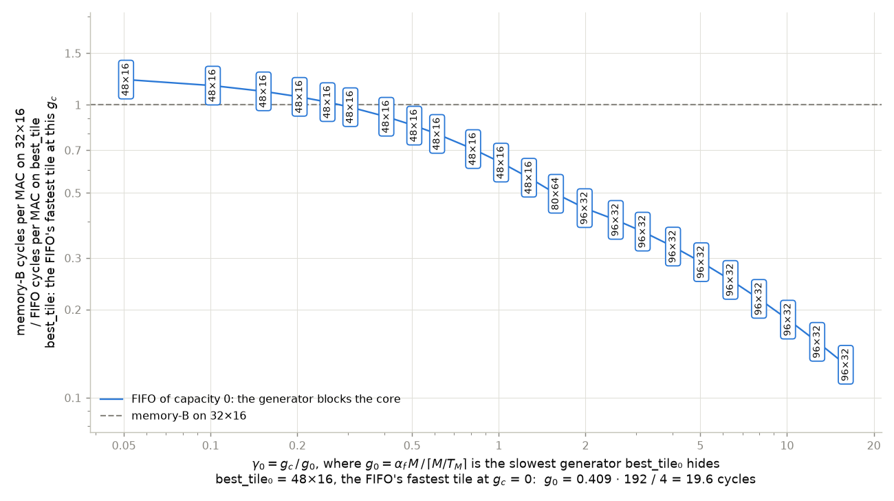
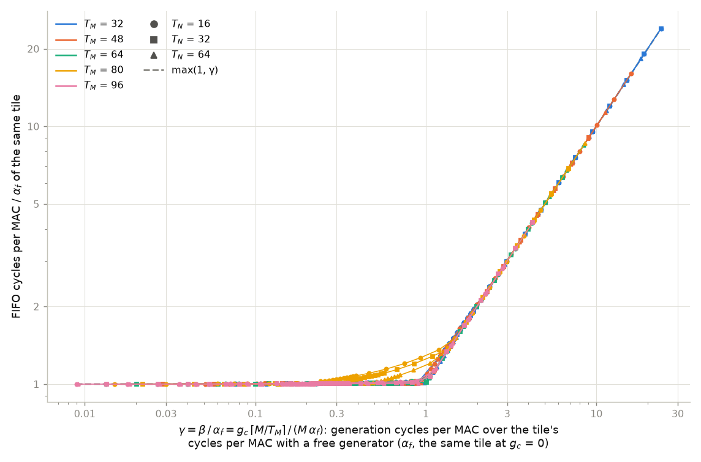
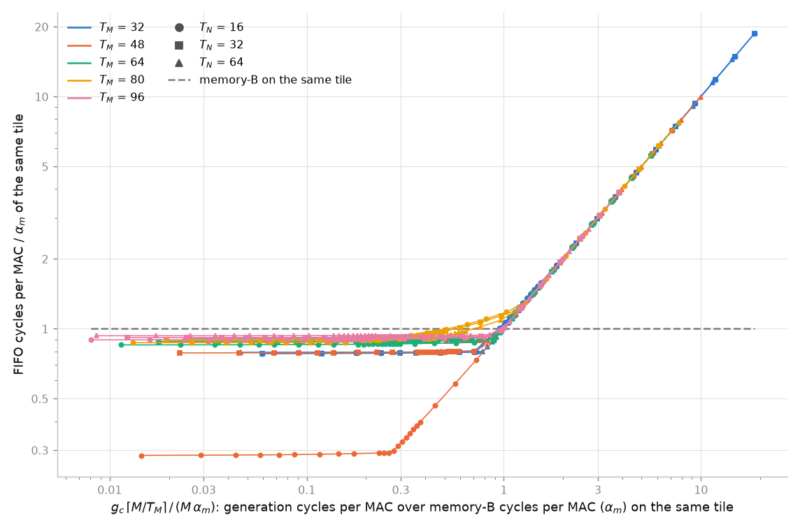
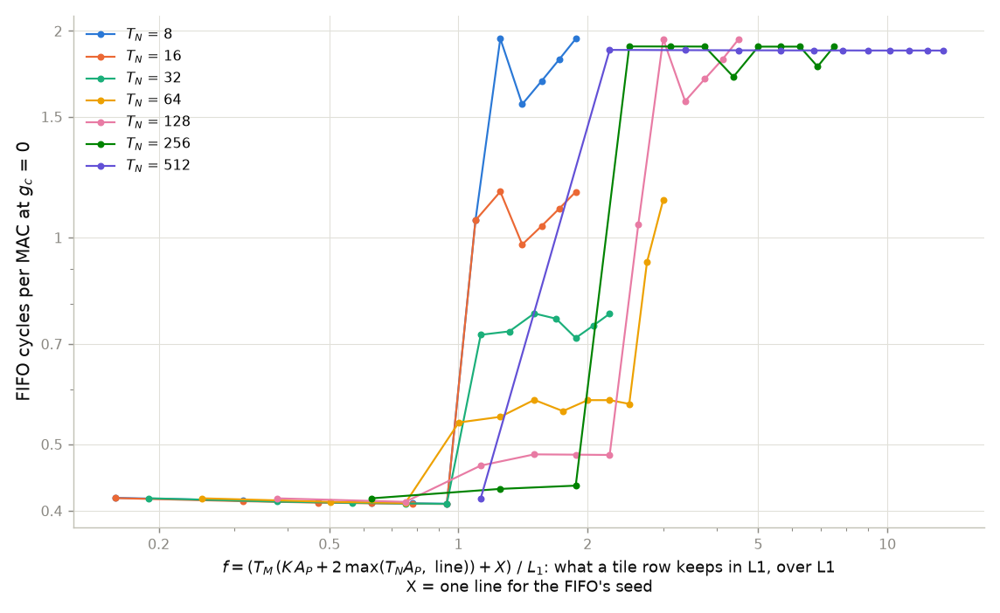
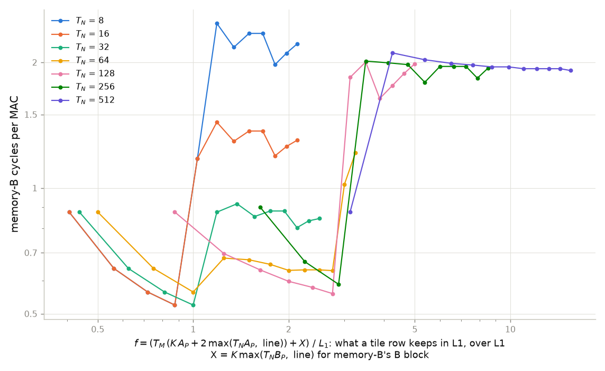

# fifo_feasibility-v2: composite graphs

Each graph here has a composite parameter on its x axis, with the formula in
the axis label. A point that comes from the fastest tile at its g_c has that
tile written in it. The working point, the runs and the notation are those of
the [main README](../README.md).

## γ₀: the FIFO's fastest tile against memory-B

γ₀ = g_c / g_0, where g_0 = α_f · M / ⌈M/T_M⌉ on best_tile₀, the FIFO's
fastest tile with a free generator. best_tile₀ is 48×16, so
g_0 = 0.409 · 192 / 4 = 19.6 cycles. Each element of B serves
48 MACs on 48×16, and the core spends 0.409 cycles on each MAC, so
g_0 is the slowest generator that tile keeps up with. The tables of the main
README divide by 19.7, from 48×8, which is within 0.5% of 48×16 with
a free generator; the two γ₀ differ by 0.1%.

Memory-B on 32×16 over the FIFO on its fastest tile at each g_c, with
the 2 KB FIFO. The FIFO is 1.28 times faster while γ₀ is small and
stops winning at γ₀ = 1.21. As the generator slows down, the fastest tile
goes through 48×16, 40×32, 48×16, 64×64, 96×32, 96×64 and 96×512. Once generation sets the
time the taller tiles win, because each element of B then serves more MACs.

The same with a FIFO of capacity 0, so every pop waits for the generator. The
FIFO stops winning at γ₀ = 0.28, which takes a generator 4.3 times faster
than with the 2 KB FIFO.

## γ: the tiles of tile_cycles.png in one graph

γ = g_c ⌈M/T_M⌉ / (M α_f) on each tile: the generator's cycles per MAC over
the tile's own cycles per MAC with a free generator, α_f.

Each run's cycles per MAC over α_f of its tile, against γ of that tile, for
the 15 tiles of tile_cycles.png. The colour gives T_M and the marker T_N. The
runs follow max(1, γ): the tile's own time while the generator keeps up, and
the generator's time after that. On the tiles whose T_M divides M they lie
within 2% of max(1, γ) away from γ = 1, and up to 8% above it for
0.5 ≤ γ ≤ 2. The 80-row tiles leave the curve early, up to
27% above it. Their last tile row is 32 rows tall, so each element of B
generated for it serves only 32 MACs, and the generator falls behind there
first.

## Generation over memory-B: where each tile stops winning

The x axis is g_c ⌈M/T_M⌉ / (M α_m) on each tile: the generator's cycles per
MAC over memory-B's cycles per MAC on the same tile, α_m. By the rule of
section 1 of the main README, a tile beats memory-B while this is below 1.

FIFO cycles per MAC over α_m of the same tile, for the same 15 tiles. Each
tile starts at its α_f / α_m, from 0.28 on 48×16 to 0.93 on 96×64, and
follows the diagonal once the generator sets the time. The tiles whose T_M
divides M cross memory-B at x = 0.94 to 1.00, the 80-row tiles at
0.52 to 0.70.

## f: where α jumps

f = (T_M (K A_P + 2 max(T_N A_P, line)) + X) / L1 is what a tile row keeps in
L1, over L1. X is one line for the FIFO's seed, or K max(T_N B_P, line) for
memory-B's B block.

Cycles per MAC with a free generator against f, one line per T_N through its
tiles in order of T_M. On the widths with several tile columns, every FIFO
tile with f ≤ 1 takes 0.409 to 0.418 cycles per MAC. Memory-B's tiles with f ≤ 1
get cheaper with T_M, from 0.876 to 0.524, because a taller tile loads B
fewer times. Past f = 1 the A band is read again for every tile column, so
the jump is larger on narrow tiles. With the FIFO it is 2.59 times at
T_N = 8, which has 64 tile columns, and 1.03 times at T_N = 256, which
has two. T_N = 512 has one tile column, so f doesn't matter there. Its jump comes
from the tile limit: past T_M·(max(T_N·A_P, line) + 2·line) = L1, C no longer
stays in L1 from one k step to the next.
